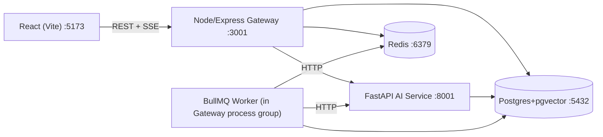

# System Architecture

## Services

## Responsibilities

| Concern | Owner |
|---|---|
| Auth (JWT), RBAC | Node |
| CRUD: documents metadata, alerts, metrics | Node |
| Job/workflow state machine, approvals, audit log | Node + BullMQ worker |
| SSE streaming to browser | Node |
| Embeddings, chunking, ingestion pipeline | Python |
| Semantic retrieval (pgvector query) | Python |
| RAG prompt construction + LLM call | Python |
| Anomaly detection, summarization | Python |
| Model/eval harness | Python |

Node never calls an LLM or embedding model directly — it proxies to the AI service over HTTP. Python never reads/writes `users`, `audit_logs`, or `workflow_runs` — it's stateless compute invoked by the gateway/worker.

## Request lifecycle (AI assistant question)
1. Browser POSTs question to Node (`/api/v1/assistant/ask`), JWT validated, RBAC checked.
2. Node forwards to FastAPI `/rag/query` over HTTP.
3. FastAPI embeds the query (embedding provider), runs pgvector cosine-similarity top-k search with metadata filters, builds a grounded prompt from retrieved chunks.
4. FastAPI calls the LLM provider (mock/OpenAI-compatible/Anthropic), returns `{answer, sources[], confidence}` — streamed via chunked HTTP.
5. Node relays the stream to the browser as SSE, persists the exchange for conversation history.

## Async job lifecycle (agentic workflow)
1. Browser requests a workflow run → Node validates inputs, writes `workflow_runs` row (`status=pending`), enqueues a BullMQ job with an idempotency key.
2. Worker picks up the job, executes steps in order; each step may call the AI service (summarize/analyze) or touch operational data (read-only).
3. If a step is flagged `requires_approval`, the worker sets `status=awaiting_approval` and stops — it does not proceed on its own.
4. A role-checked human calls `POST /workflows/runs/:id/approve`; Node re-enqueues the remainder of the run.
5. On completion/failure, the worker writes final output + audit log entries; max_steps bounds runaway loops; retries are idempotent via the stored key.

## Data flow for ingestion
Upload → Node stores file + metadata row (`status=pending`) → Node calls FastAPI `/ingest` → Python parses, chunks (configurable size/overlap), hashes content for dedup, embeds, writes `document_chunks` (with `embedding vector(384)`) → Node polls/receives completion → row `status=ready`.
